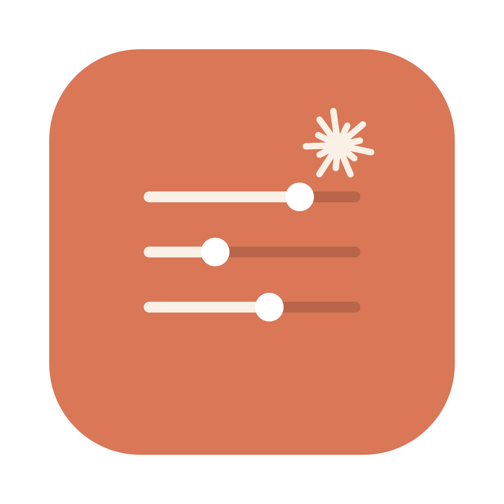
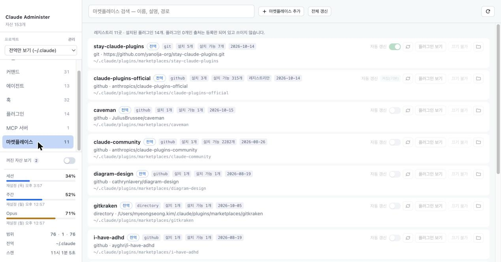
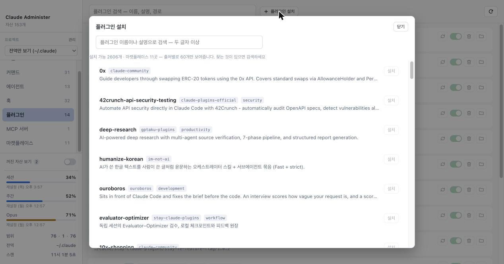

<div align="center">



# Claude Administer

**맥에 설치된 Claude Code 자산을 한 화면에서 보고 관리하는 데스크톱 앱**

스킬 · 커맨드 · 에이전트 · 훅 · 플러그인 · MCP 서버 · 마켓플레이스를
전역과 프로젝트에 걸쳐 모아 보고, 켜고 끄고, 설치하고 지운다.




</div>

---

## 왜 쓰는가

Claude Code 의 자산은 여러 곳에 흩어져 있다. 전역 `~/.claude/`, 프로젝트 `.claude/`,
그리고 설치된 플러그인이 각각 제공한다. 무엇이 어디서 왔는지, 같은 이름이 겹치면 어느
쪽이 이기는지, 지금 꺼져 있는 것이 무엇인지는 파일을 열어 봐야 알 수 있다.

이 앱은 그 전부를 한 목록에 모은다. 자산 하나하나에 출처 배지가 붙고, 겹치는 것은
`덮어씀` / `가려짐` 으로 표시된다. 끄고 켜는 것, 지우는 것, 플러그인을 새로 설치하는
것까지 화면에서 한다.

## 빠른 시작

```bash
npm install
node node_modules/electron/install.js   # Electron 44 는 postinstall 훅이 없어
                                        # 바이너리를 한 번 직접 받아야 한다
npm run dev                             # 개발 모드로 실행
```

설치해서 쓰려면:

```bash
npm run release   # 빌드 → .dmg → /Applications 설치 → 실행
```

메뉴바에 아이콘으로 상주한다. 클릭하면 사용량이 뜨고, `설정` 으로 전체 창을 연다.

## 주요 기능

| | |
|---|---|
| **모아 보기** | 전역 · 프로젝트 · 플러그인 자산을 한 목록에. 출처 배지와 충돌 표시 |
| **검색** | 이름 · 설명 · 경로 · 트리거 · 훅 명령 전문을 한 번에 |
| **켜고 끄기** | 전용 설정 키가 있는 자산. 백업 후 원자적으로 쓴다 |
| **제거** | 휴지통으로 보내기. 플러그인은 공식 CLI 로 |
| **플러그인 설치** | 마켓플레이스 2,600여 개 중에서 검색해 설치 |
| **마켓플레이스 관리** | 등록 · 갱신 · 자동 갱신 토글 |
| **사용량** | 구독 한도를 메뉴바와 사이드바에서 |

<div align="center">

<br />
<sub>플러그인 설치 — 설치된 것은 빼고, 출처를 번갈아 보여준다</sub>
</div>

## 무엇을 보여주는가

전역(`~/.claude/`), 선택한 프로젝트(`.claude/`), 그리고 설치된 플러그인이 제공하는 자산을
한곳에 모아 보여준다. 각 항목은 어느 범위에서 왔는지 배지로 표시되고, 같은 이름이
여러 범위에 있으면 어느 쪽이 우선하는지(`덮어씀` / `가려짐`) 알려준다.

프로젝트는 사이드바에서 골라 전환한다. 목록은 두 곳에서 모은다.

- **사용 기록에서 발견** — `~/.claude/projects/` 의 세션 파일에서 실제 경로(`cwd`)를 읽는다.
  디렉토리명은 경로 구분자와 이름 속 하이픈이 똑같이 `-` 로 바뀌어 역산이 불가능하므로,
  파일 내용의 `cwd` 를 유일한 근거로 쓴다. 앱을 띄울 때 자동으로 한 번 훑고, 결과를
  캐시한다 — 디렉토리 100여 개를 훑는 일이라 탭을 옮길 때마다 할 이유가 없다.
  앱을 켜 둔 채 다른 프로젝트에서 Claude Code 를 썼다면 `다시 읽기` 를 누르면
  목록에 올라온다.
- **폴더 직접 추가** — 사용 기록이 없는 새 프로젝트용. 선택은 앱 전용 파일에 저장되며
  `~/.claude/` 는 건드리지 않는다.

둘을 출처별로 묶지 않고 한 목록에 늘어놓는다. 어느 쪽에서 왔는지는 행마다 배지로
붙으므로, 묶음은 같은 정보를 두 번 말하면서 목록만 쪼갠다. 등록과 삭제는 `관리` 창으로
분리했다 — 전환은 자주 하고 등록은 드물어서, 한 컨트롤에 넣으면 자주 쓰는 동작이
드물게 쓰는 동작의 복잡도를 떠안는다.

목록에서 빼는 방식은 출처에 따라 다르다.

| 출처 | 빼면 | 되돌리기 |
|---|---|---|
| 직접 추가 | 앱의 등록 기록에서 지운다 | 폴더를 다시 추가 |
| 사용 기록에서 발견 | 가린다(숨김 목록에 넣는다) | 관리 창의 `가린 프로젝트` 에서 되돌리기 |

발견된 프로젝트를 지우지 않고 가리는 이유는 그 목록의 출처가
`~/.claude/projects/` 의 **세션 기록**이기 때문이다. 지우면 Claude Code 의 실제 대화
로그가 사라진다. 어느 쪽이든 폴더와 파일은 건드리지 않는다.

한 번에 한 프로젝트만 본다. 여러 프로젝트를 한 목록에 합치지 않는 이유는 `가려짐` 배지가
거짓이 되기 때문이다 — 가림은 같은 프로젝트 안에서 전역 대 프로젝트일 때만 일어나고,
다른 프로젝트끼리는 서로 영향이 없다.

홈(`~`)과 `Desktop` 같은 상위 폴더는 목록에서 뺀다. 그 자리에서 Claude Code 를 한 번
띄우면 `.claude/` 가 생겨 발견 조건을 통과하지만, 이들은 프로젝트가 아니라 프로젝트를
담는 그릇이고 파일 접근 허용 범위로 쓰면 그 아래 전부가 열린다.

| 탭 | 읽는 곳 |
|---|---|
| 스킬 | `skills/<name>/SKILL.md` (전역 · 프로젝트 · 플러그인) |
| 커맨드 | `commands/**/*.md` — 하위 디렉토리는 `/dir:name` 네임스페이스 |
| 에이전트 | `agents/**/*.md` |
| 훅 | `settings.json` 의 `hooks` 블록 (이벤트별로 평탄화) |
| 플러그인 | `plugins/installed_plugins.json` + `settings.json` 의 `enabledPlugins` |
| MCP 서버 | `~/.claude/mcp.json`, 프로젝트 `.mcp.json` |
| 마켓플레이스 | `plugins/known_marketplaces.json` |

## 할 수 있는 것

- **검색** — 이름 · 설명 · 경로 · 트리거 · 훅 명령 전문을 한 번에 훑는다
- **열기** — Finder 에서 위치 보기
- **프로젝트 전환** — 선택기에서 고른다. 등록·삭제는 `관리` 창에서
- **사이드바 요약** — 꺼진 자산 개수(눌러서 걸러보기) · 범위별 분포 · 마지막 스캔 시각
- **켜기 / 끄기** — 전용 설정 키가 있는 자산만
- **제거** — 휴지통으로 보내기. 플러그인은 공식 CLI 로
- **플러그인 그룹** — 플러그인이 제공하는 자산은 플러그인별로 묶어 접고 펴기
- **마켓플레이스** — 등록 · 갱신 · 자동 갱신 토글, 출처별 설치 플러그인 수
- **플러그인 설치** — 마켓플레이스 카탈로그에서 검색해 설치

### 무엇을 끌 수 있는가

Claude Code 는 자산 종류마다 끄는 방법이 다르고, 전용 키가 없는 것도 있다.
전용 키가 있는 세 종류만 토글을 제공하고, 나머지는 사유를 툴팁에 붙여
`끄기 불가` 로 보여준다 — 버튼을 숨기면 "왜 없지"를 매번 묻게 된다.

| 자산 | 끄는 방법 | 토글 |
|---|---|---|
| 스킬 (전역 · 프로젝트) | `settings.json` 의 `skillOverrides[name] = "off"` | 가능 |
| 스킬 (플러그인 제공) | `skillOverrides` 가 적용되지 않음 | 불가 — 플러그인을 끄세요 |
| 에이전트 | `permissions.deny` 에 `Agent(name)` — 이 도구는 권한 설정을 쓰지 않는다 | 불가 |
| 플러그인 | `settings.json` 의 `enabledPlugins[id] = false` | 가능 |
| 커맨드 | 전용 설정 없음 | 불가 — 파일을 옮기거나 지워야 함 |
| 훅 | `hooks` 항목을 직접 지워야 함 | 불가 — 편집기로 열어 수정 |
| MCP 서버 | `mcp.json` 항목을 직접 지워야 함 | 불가 — 편집기로 열어 수정 |
| 마켓플레이스 | 끄는 개념이 없음 (제거만 가능) | 불가 — 대신 자동 갱신을 토글 |

훅·MCP·에이전트를 토글에 넣지 않은 이유는 각각 다르다. 훅과 MCP 는 전용 스위치가
없어 원래 설정 항목을 지워야 하고, `hooks` 는 중첩 구조라 같은 안전장치를 쓸 수 없다.
에이전트는 `permissions.deny` 를 써야 하는데, 권한 설정은 어떤 명령이 자동 승인되는지를
정하므로 이 도구가 건드리지 않는다.

이 도구가 쓰는 키는 `skillOverrides` · `enabledPlugins` ·
`extraKnownMarketplaces[].autoUpdate` 셋뿐이고, 모두 전역 `~/.claude/settings.json` 에
쓴다. 적용에는 Claude Code 재시작이 필요하다.

플러그인이 제공하는 자산은 **그룹 헤더에만** 토글·이동·제거를 둔다. 그룹 안 행마다
같은 버튼을 반복하면 중복이라 토글 칸을 비우고, 헤더의 버튼으로 그 플러그인 전체를
끄거나 제거하거나 플러그인 탭으로 이동한다.

### 목록 읽기

긴 목록(스킬 116 · 커맨드 58 · 훅 64)을 훑을 수 있도록 다음을 지킨다.

- **한 줄 요약** — 설명과 경로를 각각 한 줄로 자른다. 두 줄이면 행 높이가 자산마다
  들쭉날쭉해져 훑기 어렵다. 전문은 마우스를 올리면 보인다
- **경로 줄이기** — 홈은 `~`, 그래도 길면 앞을 자른다. 한 그룹 안의 경로는 앞부분이
  거의 같고 구분되는 건 뒤쪽이다
- **그룹 안에서 반복 제거** — 그룹 전체가 같은 플러그인이므로 행마다 붙던
  `플러그인` 배지와 플러그인 ID 칩을 뺀다
- **항목 사이 간격** — 구분선 대신 여백으로 나눈다. 항목 하나가 카드 덩어리로
  읽혀 훑기 쉽다
- **들여쓰기 + 배경 대비** — 그룹 안 항목이 묶여 있음을 눈으로 보이게 한다
- **버튼은 평소 흐리게** — 행에 마우스를 올리거나 포커스가 들어오면 드러난다.
  `display` 가 아니라 `opacity` 만 바꿔 키보드 포커스는 유지된다

컨트롤은 아이콘으로 둔다. 켜기/끄기는 토글 스위치(`role="switch"` + `aria-checked`),
제거는 휴지통, 다른 탭으로 이동은 외부링크 아이콘이다. 아이콘만으로는 뜻이 전달되지
않으므로 모든 아이콘 버튼에 `aria-label` 과 `title` 을 둔다.

### 무엇을 제거할 수 있는가

| 자산 | 제거 방법 | 되돌리기 |
|---|---|---|
| 스킬 (전역 · 프로젝트) | `skills/<name>/` 디렉토리를 휴지통으로 | Finder 에서 "되돌리기" |
| 에이전트 | `agents/<name>.md` 를 휴지통으로 | Finder 에서 "되돌리기" |
| 커맨드 | `commands/**/<name>.md` 를 휴지통으로 | Finder 에서 "되돌리기" |
| 플러그인 | `claude plugin uninstall <id> --json -y` | 휴지통 안 거침 — 재설치 가능 |
| 플러그인 제공 스킬 · 커맨드 · 에이전트 | 개별 제거 없음 | 플러그인을 제거 |
| 훅 · MCP 서버 | 제거 없음 | 편집기로 열어 수정 |

제거는 두 가지를 지킨다.

1. **휴지통을 거친다.** 파일을 직접 지우지 않고 `shell.trashItem()` 으로 macOS 휴지통에
   넣는다. 사용자가 직접 쓴 47KB `SKILL.md` 를 영구 삭제하면 복구할 길이 없다.
2. **확인 대화를 한 번 띄운다.** 지워질 **대상 경로를 그대로** 보여주고, 되돌릴 수 있는지
   (휴지통) 없는지(플러그인)를 명시한다. 기본 선택은 `취소` 다.

플러그인만 예외로 공식 CLI 를 호출한다. `installed_plugins.json` 과 `plugins/cache/` 는
Claude Code 가 소유하는 파일이고, 그 포맷에 맞춰 직접 쓰면 Claude Code 의 플러그인 상태와
어긋날 수 있다. CLI 가 실패하면 그 메시지를 그대로 보여준다 — 사유를 다시 쓰면 실제
원인이 가려진다.

## 마켓플레이스

`plugins/known_marketplaces.json` 을 기준으로 읽는다. `settings.json` 의
`extraKnownMarketplaces` 보다 항목이 많고(실측 11 대 9) 설치 위치와 마지막 갱신
시각이 들어있다. 설정에는 없고 레지스트리에만 있는 출처는 `레지스트리만` 으로 표시한다.

각 출처마다 **그 출처에서 설치된 플러그인 수**를 함께 보여주고, 많은 순으로 정렬한다.
플러그인 0개인 출처는 등록만 되어 있고 쓰이지 않는 것이다 (실측: `im-not-ai`).
`플러그인 보기` 를 누르면 플러그인 탭으로 옮겨 그 출처의 것만 걸러 보여준다.

### 추가 · 갱신 · 자동 갱신

등록과 갱신은 공식 CLI(`claude plugin marketplace add` / `update`)에 맡긴다.
레지스트리와 캐시 디렉토리는 Claude Code 가 소유하므로 직접 쓰지 않는다.

자동 갱신만 예외로 설정 파일을 직접 쓴다. 그 값은 `settings.json` 의
`extraKnownMarketplaces[이름].autoUpdate` 에 있고 CLI 에 이를 설정하는 플래그가
없어서, 직접 쓰는 것이 유일한 방법이다 (Claude Code 의 `/plugin` 토글도 같은 곳을 쓴다).

상태를 세 가지로 보여준다. 플래그가 없을 때의 기본값이 출처에 따라 다르기 때문이다 —
공식 마켓플레이스는 적지 않아도 켜져 있어서, 없는 것을 `꺼짐` 으로 보여주면 거짓이 된다.

| 표시 | 뜻 |
|---|---|
| `켜짐` / `꺼짐` | `settings.json` 에 직접 적힌 값 |
| `기본 켜짐` / `기본 꺼짐` | 적힌 값이 없어 기본값을 따름 |
| `켜짐(기본)` (잠김) | 이 앱에서 바꿀 수 없음 |

잠기는 경우는 둘이다. 내장 기본 마켓플레이스는 사용자 설정에 항목 자체가 없고,
다른 프로젝트나 관리자 설정이 선언한 값은 우리가 덮어쓰면 그쪽 의도와 충돌한다
(실측: 11곳 중 2곳).

CLI 결과는 종료 코드가 아니라 `--json` 의 `outcome` 으로 판정한다. 실패해도 `0` 으로
끝나는 경우가 있고, JSON 뒤에 사람용 메시지가 붙어 "마지막 줄" 가정도 깨진다.

### 플러그인 설치

마켓플레이스 카탈로그(`marketplace.json`)를 모아 읽는다. 실측 11곳에서 2,620개가 나오고
그중 한 곳이 2,282개를 차지한다. 그래서 두 가지를 지킨다.

- **설치된 것은 목록에서 뺀다** — 이 창은 고르는 자리라, 고를 수 없는 항목이 섞이면
  세어 본 개수와 실제로 누를 수 있는 개수가 달라진다
- **출처를 번갈아 뽑는다** — 이름순으로 60개를 자르면 거의 전부 한 출처가 된다.
  번갈아 뽑으면 여섯 출처가 모두 첫 화면에 드러난다

## 개발

`npm run dev` 는 앱을 실행한 디렉토리를 "현재 프로젝트"로 본다. 다른 프로젝트를 보려면
그 디렉토리에서 실행하면 된다.

```bash
npm run typecheck   # main + renderer 타입 검사
npm run build       # out/ 에 번들 생성
npm run pack        # release/mac-arm64/ 에 .app 생성 (서명 없음)
npm run dist        # 위에 더해 release/ 에 .dmg 생성
npm run install:app # 빌드한 앱을 /Applications 에 설치하고 다시 실행
npm run release     # dist + install:app 을 한 번에
```

## 안전장치

이 도구가 쓰는 파일은 `~/.claude/settings.json` 하나뿐이고, 그 쓰기 경로는 다음을 지킨다.

1. **백업 먼저** — 쓰기 전에 `settings.json.bak-<타임스탬프>` 사본을 만든다
2. **담당 키만** — 그 변경이 맡은 키 외에는 읽은 그대로 되돌려 쓴다
3. **원자적 교체** — 임시 파일에 쓰고 `rename` 한다. 중간에 끊겨도 반쯤 덮인 파일이 남지 않는다
4. **되읽어 검증** — 쓴 뒤 다시 파싱해 값과 키 구성을 확인하고, 어긋나면 백업에서 복구한다
5. **깨진 파일은 건드리지 않음** — `settings.json` 파싱이 실패하면 아예 쓰지 않는다
6. **없는 항목은 만들지 않음** — `enabledPlugins` 에 없는 플러그인 ID 는 거부한다.
   마켓플레이스 자동 갱신은 예외로, 레지스트리에서 읽은 `source` 를 함께 넣어 완전한
   항목을 만든다 — `autoUpdate` 만 있는 항목은 Claude Code 가 무시하므로, 사용자는
   켰다고 믿는데 아무 일도 일어나지 않게 된다

renderer 에는 Node 를 주지 않는다(`contextIsolation: true`, `nodeIntegration: false`).
파일 접근은 전부 IPC 를 거치며, `열기` / `위치` 가 받는 경로는 정규화 후
`~/.claude` 와 현재 프로젝트 아래로 제한된다 — `..` 를 쓴 경로 탈출은 거부된다.

frontmatter 는 Claude Code 와 같은 너그러움으로 읽는다. `argument-hint` 처럼
사람이 읽을 문자열을 받는 필드는 따옴표 없이 대괄호를 쓰는 일이 흔한데
(`argument-hint: [list|save] [name]`), 엄격한 YAML 로는 `[` 가 flow sequence 라
깨진다. 이런 필드는 문자열로 보고 다시 읽으므로, 파서가 Claude Code 보다
엄격해서 멀쩡한 파일을 못 읽는 일은 없다. 두 번 다 실패하면 그때는 진짜
깨진 파일이므로 사유를 그대로 남긴다.

스캔은 읽기 전용이고 부분 실패를 허용한다. 파일 하나가 깨져도 스캔 전체가 멈추지 않고,
읽지 못한 파일은 화면 상단에 접힌 목록으로 모인다.

## 검증된 범위

| 대상 | 방법 | 결과 |
|---|---|---|
| frontmatter 파서 | 실제 파일 3종 + 엣지 8종 | 5/5 통과 |
| 스캐너 | 실제 자산 스캔 | 스킬 116 · 커맨드 58 · 에이전트 29 · 훅 64 · 플러그인 16 · MCP 2 |
| 충돌 탐지 | 합성 이름 충돌 주입 | 양방향 표시 확인 |
| 토글 쓰기 (3종) | 실파일 사본 대상 33개 단정 | 33/33, 실제 파일 sha256 불변 확인 |
| 프로젝트 발견 · 경로 가드 | 실제 `~/.claude/projects/` + traversal 7종 | 41/41 |
| 제거 | 임시 디렉토리의 합성 자산 대상 14개 단정 | 14/14, 실제 자산·플러그인 전부 불변 |
| 마켓플레이스 | 실제 레지스트리 대상 | 11곳, 출처별 플러그인 수 일치 |
| 권한 탭 제거 · 중복 버튼 제거 | 오프스크린 실행 후 DOM 조회 | 17/17 |
| 리스트 UI 개선 | 행 높이 · 그룹 중복 · 아이콘 · 접근성 | 24/24 (행 142px → 73px) |
| 앱 실행 (그룹 · 이동 · 제거) | 오프스크린 실행 후 실제 DOM 조회 | 33/33 통과, 콘솔 오류 0 |
| 자동 갱신 상태 판정 | 실제 레지스트리 + `settings.json` 11곳 | 잠김 2곳 포함 전부 일치 |
| 자동 갱신 쓰기 | 실파일 사본 대상 왕복(끄기 → 켜기) | 21/21, 최상위 키 21개 · hooks · permissions 불변 |
| 플러그인 CLI 파서 | 실제 `claude plugin` 호출 5종 | 7/7 (exit 0 실패 · JSON 위치 함정 포함) |
| 카탈로그 | 실제 마켓플레이스 11곳 | 2,620개 / 204ms, 직렬화 0.83MB |

에이전트 수가 19에서 29로 늘어난 것은 플러그인이 제공하는 에이전트를 이전에는
개수만 세고 목록에서 버렸기 때문이다.

## 구조

```
src/
  shared/types.ts      자산 타입 (main · renderer 공용)
  main/
    frontmatter.ts     YAML frontmatter 파서
    scanner.ts         자산 스캔 (읽기 전용)
    projects.ts        프로젝트 발견 · 선택 저장 · 허용 경로
    settings.ts        settings.json 쓰기 (백업 · 검증 · 복구)
    marketplaces.ts    마켓플레이스 목록 + 자동 갱신 상태 판정
    catalog.ts         설치 가능한 플러그인 카탈로그 읽기
    plugin-cli.ts      claude plugin CLI 호출 (--json 파싱)
    remove.ts          휴지통 이동 · 플러그인 CLI 호출
    usage.ts           구독 사용량 조회
    tray.ts            메뉴바 아이콘
    popover.ts         메뉴바 팝오버 창
    index.ts           Electron main + IPC + 경로 가드 + 확인 대화
  preload/index.ts     contextBridge — 지정한 함수만 노출
  renderer/            React UI
```

## 알려진 한계

- 설정 쓰기는 `settings.json` 의 세 키(`skillOverrides` · `enabledPlugins` ·
  `extraKnownMarketplaces[].autoUpdate`)뿐이다.
  에이전트 · 훅 · MCP 는 읽기와 "편집기로 열기"까지다
- 제거는 휴지통 이동과 플러그인 CLI 호출뿐이다. 훅과 MCP 항목은 지울 수 없다
- 제거한 자산은 다시 받아오지 않는다. 휴지통에서 되돌리거나 플러그인을 재설치해야 한다
- 한 번에 한 프로젝트만 본다. 여러 프로젝트를 나란히 비교하는 화면은 없다
- 프로젝트 발견은 Claude Code 사용 기록에 의존한다. 기록이 없는 프로젝트는
  폴더를 직접 추가해야 한다
- 마켓플레이스 제거는 `claude plugin marketplace remove` 로 한다. 이 앱은 등록 · 갱신 ·
  자동 갱신까지만 한다
- 플러그인 설정값(`pluginConfigs`)은 아직 화면에 없다. Jira 계정 같은 자격 성격
  값이 들어있어, 넣을 때는 기본 가림 처리가 필요하다
- 앱 서명이 없다. 이 기계에서는 `.app`(304MB)과 `.dmg`(128MB) 모두 그냥 실행되지만,
  다른 맥으로 옮기면 Gatekeeper 가 막는다. 그 경우 받는 쪽에서 우클릭 → 열기로
  한 번 허용하거나, 서명·공증을 붙여야 한다
