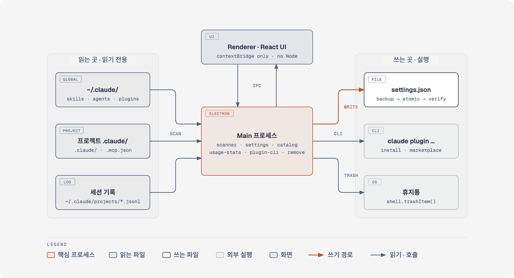
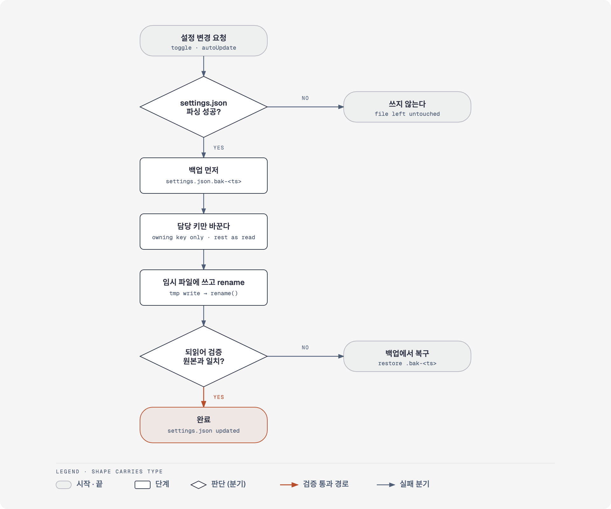

<div align="center">


# Claude Administer

**Claude Code 자산을 한 화면에서 — 보고, 켜고 끄고, 설치하고, 지운다.**

스킬 · 커맨드 · 에이전트 · 훅 · 플러그인 · MCP 서버 · 마켓플레이스 · 규칙을<br />
전역과 프로젝트에 걸쳐 **하나의 목록**으로 모아 주는 macOS 메뉴바 앱

<br />

[](#-빠른-시작)
[](https://www.electronjs.org/)
[](https://react.dev/)
[](https://www.typescriptlang.org/)
[](https://vite.dev/)
[](#)

<br />

[**빠른 시작**](#-빠른-시작) · [**주요 기능**](#-주요-기능) · [**동작 방식**](#-동작-방식) · [**안전장치**](#-안전장치) · [**개발**](#-개발) · [**상세 문서**](docs/details.md)

<br />


<sub>마켓플레이스 탭 — 출처별 플러그인 수와 자동 갱신 토글</sub>

</div>

<br />

## 💡 왜 만들었나

Claude Code 의 자산은 세 곳에 흩어져 있다. 전역 `~/.claude/`, 프로젝트 `.claude/`, 그리고 설치된 플러그인이 각자 제공하는 것들. 무엇이 어디서 왔는지, 이름이 겹치면 어느 쪽이 이기는지, 지금 꺼져 있는 것이 무엇인지는 파일을 하나하나 열어 봐야 알 수 있었다.

| 전에는 | Claude Administer 에서는 |
|---|---|
| `~/.claude/skills/`, `.claude/skills/`, 플러그인 캐시를 번갈아 연다 | 한 목록에 출처 배지가 붙어 나온다 |
| 같은 이름의 스킬이 어느 쪽에서 먹히는지 추측한다 | `덮어씀` · `가려짐` 으로 바로 표시된다 |
| `settings.json` 을 직접 고쳐 켜고 끈다 | 토글 한 번 — 백업 후 원자적으로 쓴다 |
| 안 쓰는 자산인지 세션 로그를 뒤진다 | `N회` · `판단 보류` · `미사용` 으로 판정해 준다 |

## ✨ 주요 기능

<table>
<tr>
<td width="50%" valign="top">

### 🔍 모아 보기
전역 · 프로젝트 · 플러그인 자산을 한 목록에. 출처 배지와 충돌 표시, 이름 · 설명 · 경로 · 훅 명령 전문 검색.

</td>
<td width="50%" valign="top">

### 🎚️ 켜고 끄기
전용 설정 키가 있는 자산(스킬 · 플러그인 · 자동 갱신)을 토글. 백업 후 원자적으로 쓴다.

</td>
</tr>
<tr>
<td valign="top">

### 📦 플러그인 설치
등록된 마켓플레이스 카탈로그(스크린샷 기준 2,600여 개)에서 검색해 바로 설치.

</td>
<td valign="top">

### 🗑️ 안전한 제거
파일은 휴지통으로, 플러그인은 공식 CLI 로. 지우기 전에 대상 경로를 그대로 보여준다.

</td>
</tr>
<tr>
<td valign="top">

### 📊 사용 판정
세션 기록에서 호출 횟수를 세어 `N회` · `판단 보류` · `미사용` 으로 가른다.

</td>
<td valign="top">

### 🧾 규칙 비용
매 세션 로드되는 규칙의 크기와 토큰 어림값. 조건부 규칙과 항상 로드되는 규칙을 구분한다.

</td>
</tr>
</table>

그 밖에도 메뉴바 상주 아이콘에서 구독 **사용량**(세션 · 주간 · Opus)을 바로 확인하고, 프로젝트를 사이드바에서 전환하며, 마켓플레이스 등록 · 갱신 · 자동 갱신을 관리한다.

<div align="center">
<br />

<br />
<sub>플러그인 설치 — 이미 설치된 것은 빼고, 여러 출처를 번갈아 보여준다</sub>
<br /><br />
</div>

## 🚀 빠른 시작

> **요구 사항** — Apple Silicon macOS, Node.js 와 npm, 그리고 설치된 Claude Code CLI(`claude`).

```bash
git clone git@github.com:maeng2418/claude-administer.git
cd claude-administer

npm install
node node_modules/electron/install.js   # Electron 44 는 postinstall 훅이 없어 바이너리를 한 번 직접 받는다
npm run dev                             # 개발 모드로 실행
```

설치해서 쓰려면 한 줄이면 된다.

```bash
npm run release   # 빌드 → .dmg 생성 → /Applications 설치 → 실행
```

설치하면 메뉴바에 아이콘으로 상주한다. 클릭하면 사용량이 뜨고, **설정** 으로 전체 창을 연다.

> [!NOTE]
> 앱에 서명이 없다. 빌드한 기기에서는 그대로 실행되지만, 다른 맥으로 옮기면 Gatekeeper 가 막는다.
> 받는 쪽에서 우클릭 → **열기** 로 한 번 허용하면 된다.

## 🧭 동작 방식

<div align="center">
<picture>
  <source media="(prefers-color-scheme: dark)" srcset="docs/diagrams/architecture-dark.png">
  
</picture>
</div>

**읽기는 넓게, 쓰기는 세 갈래로만.** Main 프로세스가 전역 `~/.claude/`, 프로젝트 `.claude/`, 세션 기록을 읽기 전용으로 스캔한다. 일부 파일이 깨져도 멈추지 않는다. Renderer 에는 Node 를 주지 않으며, 파일 접근은 전부 `contextBridge` 로 노출한 IPC 를 거친다. 바깥으로 나가는 쓰기는 `settings.json`, `claude plugin` CLI, 휴지통 이동 — 이 셋뿐이다.

## 🔒 안전장치

쓰기 대상은 `~/.claude/settings.json` 하나뿐이고, 모든 쓰기는 같은 경로를 지난다.

<div align="center">
<picture>
  <source media="(prefers-color-scheme: dark)" srcset="docs/diagrams/safe-write-dark.png">
  
</picture>
</div>

| 단계 | 하는 일 |
|:---:|---|
| **1 · 백업 먼저** | `settings.json.bak-<타임스탬프>` 사본을 만든다 |
| **2 · 담당 키만** | 그 변경이 맡은 키 외에는 읽은 그대로 되돌려 쓴다 |
| **3 · 원자적 교체** | 임시 파일에 쓰고 `rename` 한다 |
| **4 · 되읽어 검증** | 어긋나면 백업에서 복구한다 |
| **5 · 깨진 파일은 건드리지 않음** | 파싱이 실패하면 쓰지 않는다 |

제거는 `shell.trashItem()` 으로 휴지통을 거치고, 기본 선택이 `취소` 인 확인 대화를 한 번 띄운다. `열기` 가 받는 경로는 정규화 후 `~/.claude` 와 현재 프로젝트 아래로 제한된다.

자세한 근거와 검증 기록은 [상세 문서](docs/details.md#안전장치)에 있다.

## 🗂️ 무엇을 읽는가

| 탭 | 읽는 곳 | 켜고 끄기 |
|---|---|:---:|
| 스킬 | `skills/<name>/SKILL.md` — 전역 · 프로젝트 · 플러그인 | ✅ ¹ |
| 커맨드 | `commands/**/*.md` — 하위 디렉토리는 `/dir:name` | — |
| 에이전트 | `agents/**/*.md` | — |
| 훅 | `settings.json` 의 `hooks` 블록 | — |
| 플러그인 | `plugins/installed_plugins.json` + `enabledPlugins` | ✅ |
| MCP 서버 | `~/.claude/mcp.json`, 프로젝트 `.mcp.json` | — |
| 마켓플레이스 | `plugins/known_marketplaces.json` | 자동 갱신만 |
| 규칙 | 프로젝트 `.claude/rules/**/*.md` | — |

<sub>¹ 전역 · 프로젝트 스킬만. 플러그인이 제공하는 스킬은 플러그인을 끈다. 토글이 없는 이유는 [상세 문서](docs/details.md#할-수-있는-것)에 있다.</sub>

## 💻 개발

| 명령 | 하는 일 |
|---|---|
| `npm run dev` | 개발 모드 (실행한 디렉토리를 현재 프로젝트로 본다) |
| `npm run typecheck` | main + renderer 타입 검사 |
| `npm run build` | `out/` 에 번들 생성 |
| `npm run pack` | `release/mac-arm64/` 에 `.app` 생성 (서명 없음) |
| `npm run dist` | `.app` 에 더해 `.dmg` 생성 |
| `npm run install:app` | 빌드한 앱을 `/Applications` 에 설치하고 다시 실행 |
| `npm run release` | `dist` + `install:app` 을 한 번에 |

<details>
<summary><b>프로젝트 구조</b></summary>

```
src/
  shared/types.ts      자산 타입 (main · renderer 공용)
  main/
    frontmatter.ts     YAML frontmatter 파서
    scanner.ts         자산 스캔 (읽기 전용)
    projects.ts        프로젝트 발견 · 선택 저장 · 허용 경로
    settings.ts        settings.json 쓰기 (백업 · 검증 · 복구)
    marketplaces.ts    마켓플레이스 목록 + 자동 갱신 상태 판정
    catalog.ts         설치 가능한 플러그인 카탈로그 읽기
    plugin-cli.ts      claude plugin CLI 호출 (--json 파싱)
    remove.ts          휴지통 이동 · 플러그인 CLI 호출
    usage.ts           구독 사용량 조회 (캐시 · 429 백오프)
    usage-stats.ts     세션 기록에서 자산 호출 횟수 집계
    tray.ts            메뉴바 아이콘
    popover.ts         메뉴바 팝오버 창
    index.ts           Electron main + IPC + 경로 가드 + 확인 대화
  preload/index.ts     contextBridge — 지정한 함수만 노출
  renderer/            React UI · 사용 판정(usage-verdict.ts)
docs/
  details.md           상세 문서
  diagrams/            동작 방식 다이어그램 (HTML 원본 + PNG)
```

</details>

## ⚠️ 알려진 한계

- 설정 쓰기는 `skillOverrides` · `enabledPlugins` · `extraKnownMarketplaces[].autoUpdate` 세 키뿐이다. 에이전트 · 훅 · MCP 는 읽기와 "편집기로 열기"까지다
- 훅과 MCP 항목은 지울 수 없다. 제거는 휴지통 이동과 플러그인 CLI 호출만 지원한다
- 한 번에 한 프로젝트만 본다. 프로젝트 발견은 Claude Code 사용 기록에 의존하므로, 기록이 없으면 폴더를 직접 추가한다
- 사용 판정은 세션 기록이 남은 기간(기본 30일)만 본다. `미사용` 은 "지우세요" 가 아니라 "확인해 보세요" 다
- 마켓플레이스 제거는 `claude plugin marketplace remove` 로 한다
- Apple Silicon macOS 만 빌드 대상이다

## 📚 문서

| 문서 | 내용 |
|---|---|
| [docs/details.md](docs/details.md) | 프로젝트 발견 · 토글과 제거 규칙 · 마켓플레이스 · 규칙 비용 · 사용 판정 · 안전장치 · 검증 기록 |
| [docs/diagrams/architecture.html](docs/diagrams/architecture.html) | 동작 방식 다이어그램 원본 (라이트 · [다크](docs/diagrams/architecture-dark.html)) |
| [docs/diagrams/safe-write.html](docs/diagrams/safe-write.html) | 안전 쓰기 흐름 다이어그램 원본 (라이트 · [다크](docs/diagrams/safe-write-dark.html)) |

<br />

<div align="center">
<sub>Claude Code 를 쓰는 사람이 Claude Code 자산을 관리하려고 만들었다.</sub>
</div>
